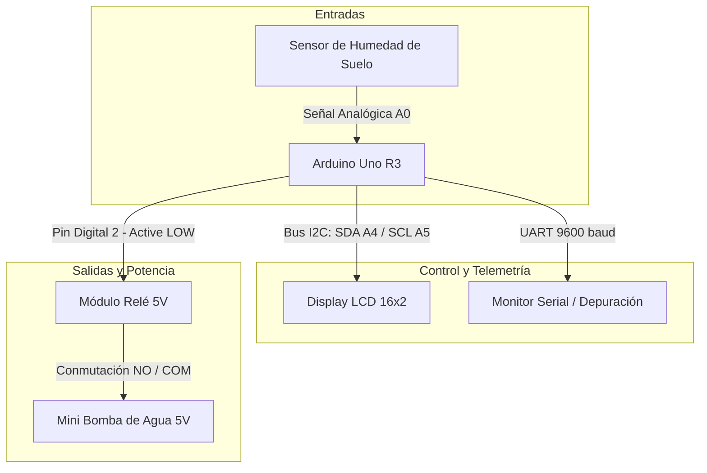
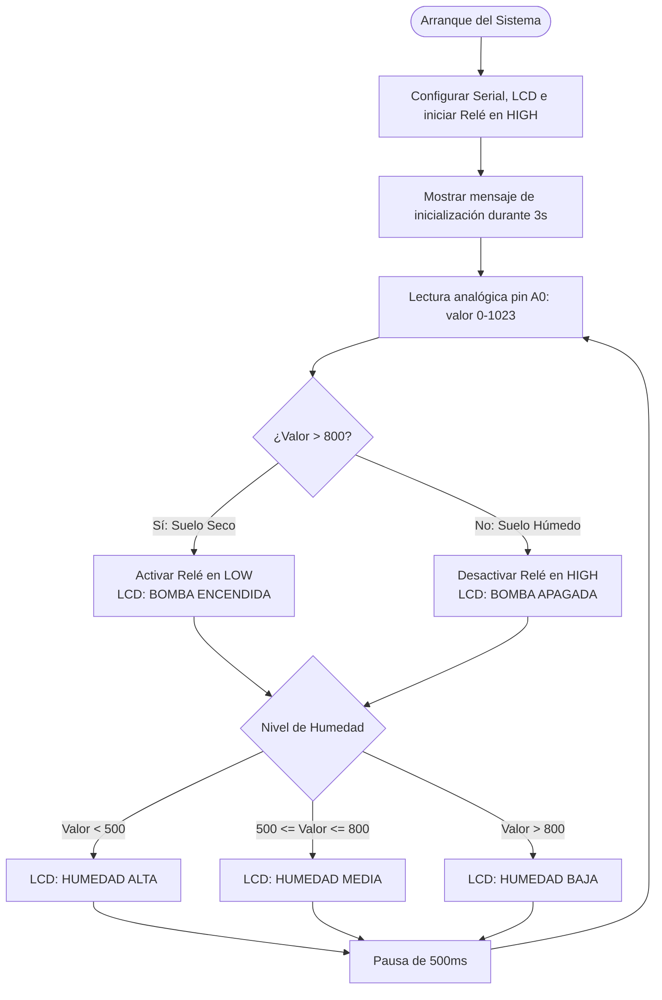

# 🌱 Sistema de Riego Automatizado con Arduino

Proyecto embebido de monitoreo y control automatizado de irrigación basado en niveles de humedad de suelo, desarrollado como demostración técnica para exposición académica.

---

## 📋 Resumen del Proyecto

Este prototipo resuelve la necesidad de optimizar el consumo de agua y automatizar el cuidado de cultivos o plantas domésticas. Utiliza un microcontrolador **Arduino Uno** que muestrea continuamente la resistencia del suelo a través de un sensor higrómetro. Al detectar niveles de sequedad por debajo de un umbral preestablecido, activa una microbomba sumergible mediante un módulo de relé, reportando el estado del sistema y las lecturas en tiempo real sobre una pantalla LCD 16x2 comunicada por protocolo I2C.

### Capacidades principales
* **Lectura continua de suelo:** Muestreo analógico mediante ADC de 10 bits.
* **Control por histéresis:** Margen entre umbrales para prevenir encendidos y apagados oscilantes (*chattering*).
* **Interfaz visual I2C:** Visualización del estado de la bomba y categorización de humedad (Baja, Media, Alta) utilizando únicamente 2 pines de datos (SDA/SCL).
* **Telemetría serial:** Transmisión de lecturas vía UART (9600 baud) para monitorización y calibración en tiempo real.
* **Manejo seguro de actuador:** Configuración de relé en lógica inversa (*Active LOW*) para evitar activaciones fortuitas durante el inicio de la placa.

---

## 🛠️ Componentes y Materiales

| Componente | Especificación | Rol en el sistema |
| :--- | :--- | :--- |
| **Microcontrolador** | Arduino Uno R3 (ATmega328P) | Unidad central de procesamiento y control |
| **Sensor de Humedad** | Módulo Higrómetro de suelo (Sonda + comparador) | Transductor de humedad a señal analógica (0 - 5V) |
| **Módulo Relé** | 1 Canal 5V (Aislamiento optoacoplado) | Interruptor electromecánico para circuito de potencia |
| **Bomba de Agua** | Mini bomba sumergible DC (3V - 5V) | Actuador hidráulico para suministro de agua |
| **Pantalla** | LCD 1602 (16 columnas x 2 filas) | Salida visual para el usuario |
| **Módulo I2C** | Adaptador PCF8574 para LCD | Expansor de bus para comunicación I2C a dos hilos |
| **Alimentación y cables** | Fuente 5V DC, protoboard y jumpers | Distribución eléctrica y cableado de señales |

---

## 🔌 Diagrama de Conexiones

### Tabla de Pines

| Periférico | Pin en Periférico | Pin en Arduino | Función / Tipo de Señal |
| :--- | :--- | :--- | :--- |
| **Pantalla LCD (I2C)** | VCC | 5V | Alimentación lógica |
| | GND | GND | Referencia común |
| | SDA | A4 | Línea de datos I2C |
| | SCL | A5 | Línea de reloj I2C |
| **Sensor de Humedad** | VCC | 5V | Alimentación de la sonda |
| | GND | GND | Referencia común |
| | A0 / AO | A0 | Salida analógica (0 - 1023) |
| **Módulo Relé** | VCC | 5V | Alimentación de bobina y optoacoplador |
| | GND | GND | Referencia común |
| | IN | Pin Digital 2 | Señal de control (LOW = Activo) |
| **Circuito Bomba** | Terminal positivo | Relé (NO - Normalmente Abierto) | Interrupción de línea positiva |
| | Terminal común | Relé (COM - Común) | Entrada de alimentación |

---

## 🧠 Lógica de Funcionamiento

El firmware implementa un bucle de control reactivo:

### Calibración de Umbrales
* `HUMEDAD_ALTA (500)`: Lecturas inferiores representan tierra saturada de agua o sumergida.
* `HUMEDAD_BAJA (800)`: Lecturas superiores indican tierra seca con conductividad baja, requiriendo irrigación inmediata.

---

## 💻 Requisitos y Puesta en Marcha

1. **Entorno de desarrollo:** Instalar [Arduino IDE](https://www.arduino.cc/en/software) (versión 2.0 o superior recomendada).
2. **Librería externa requerida:**
   * Abrir el Gestor de Librerías (`Herramientas > Administrar Bibliotecas...`).
   * Buscar e instalar: `LiquidCrystal I2C` (por Frank de Brabander o Marco Schwartz).
3. **Configuración de Hardware:**
   * Seleccionar la placa: `Herramientas > Placa > Arduino AVR Boards > Arduino Uno`.
   * Seleccionar el puerto COM asignado al conectar el cable USB: `Herramientas > Puerto`.
4. **Dirección I2C:**
   * La dirección por defecto en el código es `0x27`. Si la pantalla enciende la luz de fondo pero no muestra texto, ajustar el potenciómetro de contraste en el dorso de la placa I2C o verificar si el chip responde en la dirección alternativa `0x3F`.
5. **Carga del programa:** Pulsar el botón **Subir** (Ctrl + U) en el IDE.

---

## 🚀 Lecciones Técnicas y Posibles Mejoras (Roadmap)

Como siguiente iteración para llevar este prototipo a un nivel industrial o de producto IoT:

- [ ] **Muestreo no bloqueante:** Sustituir los retardos `delay()` por control de tiempos con `millis()` para permitir tareas concurrentes sin congelar la ejecución.
- [ ] **Sondas capacitivas:** Migrar del sensor resistivo a un sensor capacitivo v1.2 para mitigar la corrosión por electrólisis en el suelo.
- [ ] **Ahorro energético:** Desactivar la alimentación del sensor cuando no se esté realizando la lectura mediante un transistor o pin digital de habilitación.
- [ ] **Conectividad IoT:** Portar el proyecto a un microcontrolador ESP32 / ESP8266 para telemetría remota vía Wi-Fi utilizando MQTT y panel de control (Dashboard).

---

## 👤 Autor

* **Oliver Torrealba**
* GitHub: [@OliverTorrealba](https://github.com/OliverTorrealba)
* Proyecto desarrollado para exposición académica en el área de sistemas embebidos, automatización y electrónica con Arduino.
